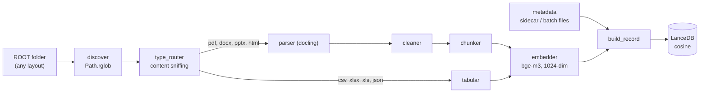

# rag-processor

The **Processor** stage of a three-part RAG system (Source → Processor → LLM).

It takes a folder of purchased files in mixed formats, parses, cleans, chunks and embeds them with `BAAI/bge-m3`, and appends the result to a LanceDB table that the LLM stage reads. Acquiring the data (Source) and answering questions (LLM) live elsewhere.

Documents also arrive continuously from [rag-collector](https://github.com/ArnavThapliyal/rag-collector) (the Source:
NSE delisting documents) through its outbox; `main.py --watch` ingests each batch as it appears. A quant stage turns
ingested price/market-cap rows into point-in-time Z-factors. See [Unified pipeline](#unified-pipeline-collector-batches-steps-quant).



## Status

All pipeline stages are implemented and covered by tests.

| Part | State |
|---|---|
| Recursive discovery, CLI, per-file failure isolation | Done |
| Type detection, zip handling | Done |
| Document parsing (PDF, DOCX, PPTX, HTML), on-demand OCR | Done |
| Tabular files (CSV, XLSX, XLS, JSON), including one-row-per-record mode for price and fundamentals files | Done |
| Vendor metadata resolution (everything optional) | Done |
| Cleaner and token-based, table-aware chunker | Done |
| bge-m3 embedding, normalised, `cuda → mps → cpu` | Done |
| LanceDB `documents` table (1024-dim, cosine, 50 financial columns), append-only | Done |
| Multiprocessing: CPU parse/chunk workers and one embedding process | Done |

Not yet done: a run over real purchased data, and tuning of chunk sizes against retrieval quality. A first partial run on scraped test data is described in [NEXT_STEPS_PLAN.md](NEXT_STEPS_PLAN.md), section 4, together with what it showed about speed.

## Setup

```bash
brew install libmagic        # required by python-magic (content sniffing)
uv sync                      # creates .venv from uv.lock (Python 3.11)
```

The first run that parses a PDF downloads docling's layout and table models; the first embedding run downloads `BAAI/bge-m3` (about 2.3 GB) into the Hugging Face cache.

## Usage

```bash
uv run python main.py /path/to/purchased/data   # a directory, crawled recursively
uv run python main.py /path/to/one/file.pdf     # or a single file
uv run python main.py                           # defaults to data/input

uv run python main.py /path/to/data --dry-run   # only list what would be processed or skipped
uv run python main.py /path/to/data --workers 4 # number of parse/chunk processes (0 = single process)
```

- There is **no required folder structure**. Folder names and depth carry no meaning.
- File types are detected from file content, with the extension as a hint. A PDF in a folder named `csv` is still a PDF.
- One bad file never stops the run. The exit code is `1` if any file failed, otherwise `0`.
- Running the same folder again is safe: files already in the table are skipped, not duplicated and not reported as failures.
- The same file delivered under two paths is ingested once.
- Logs go to stdout and `data/logs/pipeline.log`.

### Inspecting the result

```bash
uv run python view_db.py                              # summary of the default database
uv run python view_db.py /path/to/folder              # a database, or a folder that contains `lancedb/`
uv run python view_db.py "closing price" --symbol POLYCAB   # semantic search, optionally filtered by symbol
```

To write the database somewhere other than `data/lancedb`, set `LANCEDB_PATH` for the run, for example `LANCEDB_PATH=/data/drop/lancedb uv run python main.py /data/drop`. The processor never ingests its own database folder.

### How long a run takes

Text files, spreadsheets and small PDFs take seconds each. Scanned PDFs take minutes each, because they are parsed on CPU and then converted a second time with OCR. If a delivery is mostly scans, consider `ENABLE_ML_OCR=false` or `TABLE_STRUCTURE_MODE=fast` (see configuration). A run can be stopped and started again; finished documents are skipped.

### What is skipped during discovery

- Hidden files and anything inside a hidden directory (`.git`, `.DS_Store`).
- Symlinks.
- The pipeline's own working directories (scratch, logs, LanceDB).
- Metadata files: `*.meta.json`, `metadata.json`, `manifest.json`. They are read, never ingested. A real data file with one of these names will be skipped, so rename it.

Unsupported files (`.doc`, `.ppt`, unknown types) are counted as skipped and logged with a reason.

### Vendor metadata (all optional)

Nothing fails when metadata is missing or malformed; the field is simply null.

| Source | Location | Scope |
|---|---|---|
| Sidecar | `<filename>.meta.json` next to the file | That file. Highest priority. |
| Batch file | `metadata.json` in the file's directory or any parent up to ROOT | `{"defaults": {...}, "files": {"<filename>": {...}}}`. The nearest directory wins. |

Common vendor spellings are mapped (`ticker` → `symbol`, `url` → `source_url`, `roles` → `allowed_roles`, and so on). A key that exactly matches one of the financial columns (for example `isin`, `close`, `roe_pct`) fills that column. Anything unrecognised is kept in `metadata_json`.

## Unified pipeline: collector batches, steps, quant

### Continuous ingestion from rag-collector

```bash
uv run python main.py --watch                         # outbox: COLLECTOR_OUTBOX (default ../rag-collector/data/export)
uv run python main.py --watch /path/to/outbox --once  # what is pending, then exit
COLLECTOR_OUTBOX=/data/outbox uv run python main.py --watch --poll 30
```

rag-collector writes one immutable batch per export: `files/` (documents + `<name>.meta.json` sidecars in the keys
above: `source_url`, `doc_type`, `vendor`, `symbol`/`nse_symbol`/`isin`, `published_at`, plus `collector_*` provenance
that lands in `metadata_json`), `universe.sqlite3` (point-in-time universe snapshot), `manifest.json` and `READY`
(written last). The processor:

- reads only batches with `READY`, and verifies the manifest hash, contract version, paths and every file's sha256
  before ingesting; a batch that fails verification is rejected and recorded, never ingested;
- never writes into the outbox; its own ledger `data/processed_batches.jsonl` records every attempt;
- retries a batch with failed files (already indexed documents are skipped by `doc_id`) up to `BATCH_MAX_ATTEMPTS`;
- installs the universe snapshot to `data/universe/universe.sqlite3` with SQLite's backup API (newest batch wins);
- after new batches runs `quant-sync`, and `quant-zfactor` when new market rows arrived.

Stop with Ctrl-C, SIGTERM or `touch data/STOP`. A SIGTERM during an ingest terminates the worker processes and leaves
the batch unrecorded, so it is picked up again. Child processes exit on their own if the main process is killed.
Each step result is appended to `data/logs/watch.jsonl`.

### Steps

Every stage is also a step with one JSON result on stdout (contract: `pipeline/stepkit.py`, identical to
rag-collector's; exit 0 ok/noop/partial, 1 failed, 2 blocked, 75 retry later), so rag-unified can run each one:

```bash
uv run python -m pipeline.steps list
uv run python -m pipeline.steps status          # LanceDB rows, outbox ready/pending, ledger, universe, quant
uv run python -m pipeline.steps ingest --next   # or --all, or --batch <outbox>/<id>
uv run python -m pipeline.steps ingest-dir /path/to/purchased
uv run python -m pipeline.steps quant-sync
uv run python -m pipeline.steps quant-zfactor --target-min-cr 3500 --target-max-cr 12500
uv run python -m pipeline.steps quant-bracket --schedule        # or --date 2010-06-01
uv run python -m pipeline.steps health
```

`ingest` and `ingest-dir` share one lock (one LanceDB writer at a time); `quant-sync` and `quant-zfactor` share another.

### Quant stage (`pipeline/quant/`)

Sanidhya's point-in-time store and Z-factor engine from Unified_Pipeline, moved without logic changes:

- `quant-sync` upserts the universe snapshot's entities and delisting events into `data/quant.sqlite3`, and reads
  the typed rows (`trade_date`, `close`, `market_cap_cr`, `quarter_ending`, ...) that record-mode tabular ingestion
  wrote to `documents` since the last sync, into `daily_market_data` / `quarterly_fundamentals`.
- `quant-zfactor` computes cross-sectional Z-scores of log market cap per date with zero lookahead, size brackets
  (MEGA..MICRO), and the target bracket (default ₹3,500–12,500 Cr, translated to each date). Delisted companies drop
  out after their delisting date. Results go to the quant DB and the `quant_factors` LanceDB table.
- Without price files carrying `market_cap_cr`, `quant-zfactor` is a `noop` (`no_price_rows` / `no_market_cap_cr_values`).
  Price files reach the processor as purchased data (`ingest-dir`) or through a collector batch.

## The LanceDB contract

| Item | Value |
|---|---|
| Table | `documents` |
| Vector column | `embedding`, fixed-size list of 1024 float32 (bge-m3 dense) |
| Distance | cosine |
| `doc_id` | first 32 hex chars of `sha256(file bytes)` |
| `chunk_id` | first 32 hex chars of `sha256(doc_id \0 chunk_index \0 chunk text)` |
| `content_kind` | `prose` or `table` (tables stay separable for a later relational store) |
| `allowed_roles` | top-level nullable list of strings (read by the OPA policies) |
| Financial columns | 50 nullable typed columns (prices, fundamentals, shareholding, announcements) |
| `quant_factors` table | derived, no vectors: `isin`, `nse_symbol`, `trade_date`, `market_cap_cr`, `z_factor_mcap`, percentile, rank, size bracket, target-bracket flags; rewritten by `quant-zfactor` |

LanceDB does not store the metric in the table schema. It is applied when an index is built and when a query runs, so readers must search with `metric("cosine")` (see `VECTOR_INDEX_KWARGS` in `pipeline/schema.py`).

Full column list and coercion rules: [Doc/current/03_schema.md](Doc/current/03_schema.md).

## Configuration

Everything is in `config/settings.py` and can be overridden with an environment variable of the same name, for example:

```bash
NUM_WORKERS=8 EMBED_BATCH_SIZE=128 LANCEDB_PATH=/mnt/db uv run python main.py /data/in
```

The embedding device is chosen automatically in the order `cuda → mps → cpu`; set `EMBED_DEVICE` to force one. See [Doc/current/05_configuration.md](Doc/current/05_configuration.md).

## Tests

```bash
uv run pytest               # fast tests; the embedding model is stubbed, nothing is downloaded
RUN_SLOW=1 uv run pytest    # also the docling PDF/OCR tests and the real bge-m3 test (downloads models once)
```

The `.rego` files under `tests/` are OPA policies for the LLM side and are run by `.github/workflows/opatest.yml`. They are kept here because the schema's `allowed_roles` column must stay compatible with them.

## Documentation

| File | Contents |
|---|---|
| [Doc/current/01_overview.md](Doc/current/01_overview.md) | Scope, data flow, module map |
| [Doc/current/02_ingestion_workflow.md](Doc/current/02_ingestion_workflow.md) | Discovery, routing, metadata, failure model |
| [Doc/current/03_schema.md](Doc/current/03_schema.md) | LanceDB columns, ids, vector and metric, financial fields |
| [Doc/current/04_processing_stages.md](Doc/current/04_processing_stages.md) | Process layout, parser, cleaner, chunker, tabular, embedder, store |
| [Doc/current/05_configuration.md](Doc/current/05_configuration.md) | Settings and environment variables |
| [Doc/current/06_development.md](Doc/current/06_development.md) | Repo layout, tests, conventions |
| [NEXT_STEPS_PLAN.md](NEXT_STEPS_PLAN.md) | What was implemented, and what remains |
| [HANDOFF.md](HANDOFF.md) | Session-to-session progress notes |
| [refactoring_flags.md](refactoring_flags.md) | The original audit and approved plan |
