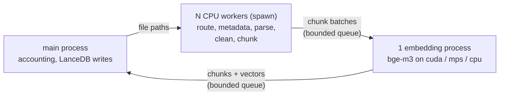

# 4. Processing stages

## Process layout (`pipeline/indexer.py`)

| Process | Count | Device | Does |
|---|---|---|---|
| Main | 1 | CPU | Starts the others, builds rows with `build_record`, writes to LanceDB, keeps the per-file accounting, builds indexes. Never imports torch. |
| Parse/chunk worker | `NUM_WORKERS` | CPU | Everything in `pipeline/worker.py`: route, metadata, parse, clean, chunk, or stream tabular rows. |
| Embedder | 1 | `cuda → mps → cpu` | The only process that loads bge-m3. Collects texts from all workers into one batch per encode call. |

- Processes are started with `spawn`. Nothing is forked after torch or MPS is initialised.
- Both queues are bounded (`EMBED_QUEUE_MAX_BATCHES`). When embedding is the bottleneck, workers block instead of filling memory.
- Every message for a file travels worker → embedder → main in order, so main always receives a file's chunks before its completion message.
- `--workers 0` (or `NUM_WORKERS=0`) runs the same steps inline in one process, for tests and debugging.

### File statuses

| Status | Meaning | Counts as |
|---|---|---|
| `indexed` | Rows written | indexed |
| `empty` | Readable, but no text or rows | skipped |
| `skipped_duplicate` | Same bytes already in the table, or seen earlier in this run | skipped |
| `skipped_unsupported` | `.doc`, `.ppt`, unknown type | skipped |
| `failed` | Any error while routing, parsing, embedding or writing | failed (exit code 1) |

A zip archive produces one status per member.

### Failure handling

- An exception in a worker is caught per file and reported as `failed` with the reason.
- A worker that dies (for example a crash inside a native parser) or reports nothing for `WORKER_STALL_TIMEOUT_SECONDS` fails only the file it was on. A replacement worker is started.
- An embedding error is retried per file, so one bad text fails one file, not the whole batch.
- If the embedding process cannot start or dies, the run stops with an error. Nothing half-written is left behind (see the vector store below).

### Known limits

- A zip archive is a single task: its members are processed one after another by the worker that picked it up. A large archive of scanned PDFs occupies one worker for a long time.
- If the main process is killed (not interrupted with Ctrl-C), workers that are in the middle of a long parse keep running until that parse returns. Check for leftover `multiprocessing.spawn` processes after a hard kill.
- Identical files that reach two workers at the same moment are both parsed; only one is stored.

## Worker steps (`pipeline/worker.py`)

`process_path(path, ctx)` yields chunk batches followed by exactly one result per routed item. It never raises for a bad file or missing metadata. Each worker keeps its own metadata cache and tokenizer, and creates the docling parser only when it meets its first document, so a worker that handles only tabular files never loads docling.

## Parser (`pipeline/parser.py`)

`Parser().parse(path)` returns a `ParseResult`: a list of `Block`s, the page count, the pages that were OCRed, and warnings.

- Uses docling for PDF, DOCX, PPTX and HTML.
- Block types: `header` (with level), `paragraph`, `list_item`, `table`, `caption`, `footnote`, `code`. Each block carries a `page_number`, or `None` for formats without pages.
- Tables keep their structure as `TableData` (header + rows). A first row that looks like a header is promoted to the header.
- Page headers and footers are in docling's furniture layer and are excluded.
- **OCR is on demand.** A document is first parsed without OCR. If pages have fewer than `min_chars_per_page_before_ocr` characters and their count is within `max_pages_for_ocr`, the document is converted again with OCR (RapidOCR, torch backend). RapidOCR covers English and Chinese, not Hindi.
- Docling runs on CPU with one thread (`PARSER_DEVICE`, `PARSER_THREADS`), so several workers can run side by side and the embedding process is the only user of the GPU/MPS device.

## Cleaner (`pipeline/cleaner.py`)

`clean_blocks(blocks, page_count)` returns the kept blocks and a log of what was removed. It is a pure function.

Removed:

- Paragraphs matching `CLEAN_DENYLIST_PATTERNS` ("Page 3 of 12", rule lines, scanner stamps).
- Printed page numbers: a bare number that is the first or last block on its page and either equals the page number or follows the same offset on at least three pages. A bare number anywhere else is kept, because the cells of a table that docling failed to recognise arrive as loose numbers.
- Running headers and footers: a paragraph of at most `CLEAN_MAX_BOILERPLATE_CHARS` characters that appears on at least `CLEAN_REPEAT_PAGE_FRACTION` of the pages, in documents of at least `CLEAN_MIN_PAGES_FOR_REPEAT` pages.

Never removed by the repetition rule: headings, tables, list items, captions, footnotes, code, and value-like text such as "Nil", "N.A." or "12.5%", which repeats legitimately in filings.

Whitespace is collapsed only in running text. Tables, list items and code are left as they are. Page numbers stay on the blocks as data.

## Chunker (`pipeline/chunker.py`)

`chunk_document(blocks, size_fn=token_counter())` returns `schema.Chunk` objects. It is a pure function.

- **Sizes are in bge-m3 tokens.** `token_counter()` loads the model's tokenizer through the `tokenizers` package, which does not import torch. If the tokenizer cannot be loaded it falls back to a character estimate and logs a warning.
- No prose chunk exceeds `CHUNK_SIZE_TOKENS`. An oversized paragraph is split by sentence, then by word, then by character.
- A level-1 or level-2 heading starts a new chunk. Deeper headings stay inline. A heading is never left as the last line of a chunk.
- Consecutive chunks inside a section overlap by up to `CHUNK_OVERLAP_TOKENS`. There is no overlap across a section boundary or a table.
- `section_path` is the heading breadcrumb where the chunk starts. `page_range` comes from the blocks the chunk contains and is null for formats without pages.
- **Tables are never mixed into prose.** Each table goes through `tabular.table_chunks`: whole rows, header repeated in every chunk, `content_kind="table"`. A caption directly before or after the table is attached to its first chunk.

## Tabular (`pipeline/tabular.py`)

`read_table_chunks(path, source_type, ...)` streams a CSV, XLSX, XLS or JSON/JSONL file and yields table chunks. Memory stays bounded for large files.

Two modes, chosen per sheet:

| Mode | When | Chunk | Typed columns |
|---|---|---|---|
| Row groups | Default | Up to `TABULAR_ROWS_PER_CHUNK` whole rows as a Markdown table with the header repeated | Not filled per row |
| Record | The header names at least `TABULAR_RECORD_MIN_MATCHES` financial columns (`trade_date`, `close`, `roe_pct`, ...) and `TABULAR_RECORD_MODE=auto` | One chunk per row, text as `column: value` lines | Filled from the row; a `symbol`/`ticker` column sets the row's `symbol` |

Record mode is what puts real values into columns such as `close`. It also means one vector per row, so a large price file produces many rows in LanceDB. Set `TABULAR_RECORD_MODE=off` to always use row groups.

Other behaviour:

- Blank or duplicate header cells are repaired. CSV encoding falls back from UTF-8 to cp1252 to latin-1, and the delimiter is sniffed.
- Nested JSON objects are flattened to dotted column names.
- An unparseable CSV row or JSONL line is skipped and counted in a warning; it does not fail the file.
- Files longer than `TABULAR_MAX_ROWS_PER_FILE` are truncated with a warning.

### Tables stay locatable

Every table chunk, from a tabular file or from inside a document, carries in `metadata_json`:

| Key | Meaning |
|---|---|
| `table_id` | `<doc_id>:<table_ordinal>`; identical for all chunks of one table, stable across runs |
| `table_ordinal` | Sheet number, or the table's position in the document |
| `sheet` | Sheet name (spreadsheets) |
| `row_start`, `row_end` | 1-based data-row range covered by the chunk |
| `columns` | Column names (row-group chunks) |
| `caption` | Table caption, when the document had one |

With `content_kind="table"` and these keys, a later job can select all table chunks, or re-read exactly those rows from the source file, to load a relational store. Raw cell values are not duplicated in LanceDB.

## Embedder (`pipeline/embedder.py`)

`Embedder().encode(texts)` returns a float32 matrix of shape `(n, 1024)`.

- Device: `EMBED_DEVICE` if set, otherwise `cuda`, then `mps`, then `cpu`.
- Vectors are L2-normalised, so cosine distance equals one minus the dot product.
- Texts are sorted by length and encoded in batches of `EMBED_BATCH_SIZE`; results come back in the input order.
- On an out-of-memory error the batch size is halved and the batch retried; the smaller size is kept for the rest of the run.
- **Fixed shapes on MPS.** Apple's MPS backend keeps memory for every distinct batch shape (rows × tokens) and never releases it; with naturally varying batches its memory grew to about 60 GB within a few dozen calls. On MPS every batch is therefore padded to one of at most 15 shapes (4, 16 or `MPS_MAX_BATCH_SIZE` rows; 64 to 1024 tokens in powers of two), which keeps memory flat. Padding does not change the vectors.
- If the device is out of memory even for a single text, the embedder moves to CPU and carries on, slowly, so the run still completes.
- Inputs longer than `EMBED_MAX_SEQ_LENGTH` tokens are truncated by the model. Prose chunks are always shorter; only a single very wide table row can reach it.
- Half precision is used only with `EMBED_FP16=true` on CUDA.
- Importing the module loads neither torch nor the model. There is no deduplication in the embedder.

## Vector store (`pipeline/vector_store.py`)

- Opens or creates the `documents` table from `ChunkRecord`. An existing table with a different schema is refused with a message naming the differences.
- Append-only. Rows are validated against the Arrow schema before the write.
- **A document is written in one atomic `add` when its last chunk has arrived.** "This `doc_id` is in the table" therefore means "this document is complete", which is what makes skip-if-present safe.
- A document with more than `WRITE_MAX_ROWS_PER_ADD` rows is written in parts. Its `doc_id` is kept in a small ledger file (`_inflight_docs.json` in the database directory) until the last part is written. If a run is killed in between, the next run deletes that document's rows before starting.
- `finalize()` runs once per run: scalar indexes on `doc_id` and `symbol`, and the cosine vector index (IVF-PQ) once the table has at least `VECTOR_INDEX_MIN_ROWS` rows. Below that, searches are exact brute-force scans.
- Only `count()`, `has_doc()`, `existing_doc_ids()` and `get_by_doc_id()` are provided for reading. Retrieval belongs to the LLM stage.
